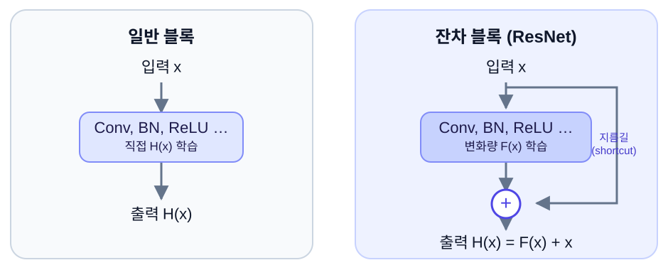

  
COMPUTER VISION · PAPER TO PRACTICE

  <h1>컴퓨터 비전, 이해하고 구현하기</h1>
  
논문을 읽었다는 것과 이해했다는 것은 다릅니다. 여기서는 <strong>왜 이 문제가 생겼는지</strong>부터 살펴보고, 핵심 아이디어를 직접 설명하고, 코드를 실행하고, 결과를 비판적으로 읽습니다.

  
<a class="md-button md-button--primary" href="papers/resnet/">첫 번째 수업: ResNet 시작하기</a> <a class="md-button" href="guide/">학습 방법 보기</a>

## 어디서부터 읽으면 좋을까요?

  <a class="study-card" href="basics/cnn/"><strong>① CNN 기초 다지기</strong>합성곱, 특징 맵, 채널, 입력·출력 텐서의 의미를 이해합니다.</a>
  <a class="study-card" href="papers/resnet/01-problem/"><strong>② ResNet이 등장한 이유</strong>네트워크를 더 깊게 했는데 왜 훈련 성능이 나빠졌을까요?</a>
  <a class="study-card" href="papers/resnet/02-residual/"><strong>③ Residual Connection</strong>H(x)를 직접 배우는 대신 F(x)=H(x)-x를 배우는 이유를 확인합니다.</a>
  <a class="study-card" href="papers/resnet/05-lab/"><strong>④ PyTorch로 검증하기</strong>작은 ResNet을 구현하고 shape와 gradient를 검사합니다.</a>

## 첫 번째 학습 주제: ResNet

**Deep Residual Learning for Image Recognition** — Kaiming He, Xiangyu Zhang, Shaoqing Ren, Jian Sun, CVPR 2016 ([원문 PDF](https://arxiv.org/pdf/1512.03385))

  핵심 질문: 깊은 모델은 왜 어려운가?
  필수 개념: CNN·역전파
  핵심 수식: H(x) = F(x) + x
  실습: PyTorch·CIFAR-10

{ .study-diagram }

**이 그림에서 기억할 것:** 일반 블록은 입력을 전부 변환해 출력하려 합니다. 잔차 블록은 원래 입력을 옆으로 전달하고, 학습한 **변화량**만 더합니다. 단, 텐서의 크기가 다르면 바로 더할 수 없고 별도의 변환이 필요합니다.

!!! tip "첫 논문 학습 후 도달할 목표"
    'ResNet은 skip connection을 쓴다'를 외우는 데서 끝나지 않고, **성능 저하 문제를 논문의 실험 결과로 설명**하고, **Residual Block의 수식과 코드**, 그리고 **언제 shortcut에 projection이 필요한지**를 말할 수 있게 됩니다.

## 이 사이트의 읽기 원칙

1. **먼저 문제를 이해합니다.** 해결책을 보기 전에 기존 모델이 왜 어려움을 겪었는지 확인합니다.
2. **용어를 정의합니다.** 영어 용어만 암기하지 않고 일상 언어와 작은 예제로 의미를 잡습니다.
3. **수식의 각 기호를 해석합니다.** 수식을 한 줄 읽은 뒤 작은 숫자로 바꿔 생각합니다.
4. **구현으로 검증합니다.** 추론 결과뿐 아니라 입력·출력 shape와 역전파 가능 여부를 확인합니다.
5. **논문 수치와 내 실험을 구분합니다.** 동일 데이터셋·설정이 아니라면 성능을 직접 비교하지 않습니다.

**다음 단계:** [학습 안내](guide.md) → [기초 CNN](basics/cnn.md) → [ResNet 단원](papers/resnet/index.md)
